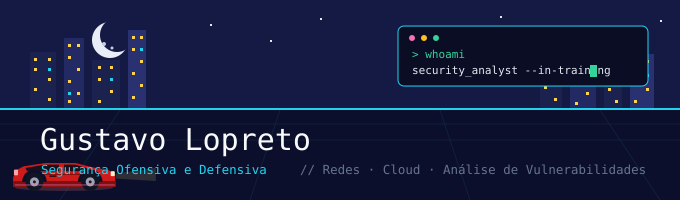

  

<h1 align="center">Gustavo Lopreto</h1>

  <strong>Estudante de Segurança Cibernética</strong> 
  Segurança Ofensiva e Defensiva · Redes e Cloud · Análise de Vulnerabilidades

  
  

## `> whoami` &nbsp; Sobre mim

Estudante de Segurança Cibernética no SENAI (formatura em dez/2027), com foco em **pentest**, **análise de vulnerabilidades** e **segurança de redes**. Transito entre o lado ofensivo e o defensivo: tanto encontrar e explorar falhas quanto entender como detectá-las e corrigi-las.

## `> ls skills/` &nbsp; Habilidades e Ferramentas

**Segurança Ofensiva**

**Segurança Defensiva e Redes**

**Linguagens e Ferramentas**

## `> cat projetos.md` &nbsp; Projetos em destaque

| Projeto | Descrição |
|---------|-----------|
| [**simoc-nmap-vuln-reporter**](https://github.com/GustavoLopreto/simoc-nmap-vuln-reporter) | Automação em Python que processa saída XML do Nmap e gera relatórios classificados por risco, com correlação CVE/CVSS (Projeto Integrador em equipe). |
| [**cve-2025-54068-vuln-intel**](https://github.com/GustavoLopreto/cve-2025-54068-vuln-intel) | Inteligência de vulnerabilidade sobre o RCE no Laravel Livewire: cálculo de CVSS v4 do zero e priorização com EPSS/KEV. |
| [**bola-api-pentest-lab**](https://github.com/GustavoLopreto/bola-api-pentest-lab) | Pentest de autorização (BOLA – OWASP API Security) em laboratório autorizado, com dossiê de metodologia, evidências e reteste. |
| [**network-observatory-incident-analysis**](https://github.com/GustavoLopreto/network-observatory-incident-analysis) | Investigação de incidente a partir de capturas PCAP no Wireshark: inferência de topologia, inventário de ativos e linha do tempo. |
| [**hardware-offensive-security**](https://github.com/GustavoLopreto/hardware-offensive-security) | Segurança ofensiva com hardware (Bash Bunny e WiFi Pineapple): payloads HID/BadUSB e análise de redes sem fio. |
| [**ctf-writeups**](https://github.com/GustavoLopreto/ctf-writeups) | Writeups de CTF com foco em metodologia e aprendizado (SQL Injection, bypass de autenticação, colisão de hash). |

## `> stats --me` &nbsp; GitHub Stats

  
  

  

## `> cat contato.txt` &nbsp; Contato

- **LinkedIn:** [linkedin.com/in/gustavo-lopreto](https://www.linkedin.com/in/gustavo-lopreto)
- **GitHub:** [github.com/GustavoLopreto](https://github.com/GustavoLopreto)
