  

<h1 align="center">Gustavo Lopreto</h1>

  <strong>Estudante de Segurança Cibernética</strong> 
  Pentest · Blue Team · Análise de Vulnerabilidades · Redes

  &nbsp;
  &nbsp;
  

  

## `> whoami` &nbsp; Sobre mim

Estudante de **Segurança Cibernética** no SENAI de São Caetano do Sul (formatura dez/2027), com foco em **pentest**, **análise de vulnerabilidades** e **segurança de redes**. Transito entre o lado ofensivo e o defensivo: tanto encontrar e explorar falhas quanto entender como detectá-las e corrigi-las.

Atualmente buscando **estágio na área de cibersegurança** para aplicar na prática o que estudo em laboratório.

## `> ls skills/` &nbsp; Habilidades e Ferramentas

**Segurança Ofensiva**

**Segurança Defensiva e Redes**

**Linguagens e Ferramentas**

## `> cat projetos.md` &nbsp; Projetos em destaque

<table>
<tr>
<td width="50%" valign="top">

### [simoc-nmap-vuln-reporter](https://github.com/GustavoLopreto/simoc-nmap-vuln-reporter)
Automação Python que processa XML do Nmap e gera relatórios classificados por risco, com correlação CVE/CVSS.
 
`python` `nmap` `cvss` `owasp`

</td>
<td width="50%" valign="top">

### [cve-2025-54068-vuln-intel](https://github.com/GustavoLopreto/cve-2025-54068-vuln-intel)
Inteligência de vulnerabilidade sobre RCE no Laravel Livewire: CVSS v4 do zero e priorização com EPSS/KEV.
 
`cve` `threat-intel` `cvss`

</td>
</tr>
<tr>
<td width="50%" valign="top">

### [bola-api-pentest-lab](https://github.com/GustavoLopreto/bola-api-pentest-lab)
Pentest de autorização (BOLA – OWASP API Security) em laboratório autorizado, com dossiê e reteste.
 
`pentest` `api-security` `owasp`

</td>
<td width="50%" valign="top">

### [network-observatory-incident-analysis](https://github.com/GustavoLopreto/network-observatory-incident-analysis)
Investigação de incidente via capturas PCAP no Wireshark: topologia, inventário de ativos e linha do tempo.
 
`forensics` `wireshark` `incident-response`

</td>
</tr>
<tr>
<td width="50%" valign="top">

### [hardware-offensive-security](https://github.com/GustavoLopreto/hardware-offensive-security)
Segurança ofensiva com hardware (Bash Bunny e WiFi Pineapple): payloads HID/BadUSB e análise wireless.
 
`red-team` `badusb` `wifi`

</td>
<td width="50%" valign="top">

### [ctf-writeups](https://github.com/GustavoLopreto/ctf-writeups)
Writeups de CTF com foco em metodologia: SQL Injection, bypass de autenticação, colisão de hash.
 
`ctf` `web-security` `writeups`

</td>
</tr>
<tr>
<td width="50%" valign="top">

### [python-port-scanner](https://github.com/GustavoLopreto/python-port-scanner)
Scanner de portas TCP em Python, do zero: de porta única a multithread com banner grabbing e relatório.
 
`python` `networking` `sockets`

</td>
<td width="50%" valign="top">

### [digital-security-handbook-vozes-periferias](https://github.com/GustavoLopreto/digital-security-handbook-vozes-periferias)
Manual de segurança digital acessível para pequenas empreendedoras: MFA, senhas, backup, engenharia social.
 
`education` `security-awareness` `digital-inclusion`

</td>
</tr>
</table>

## `> cat formacao.txt` &nbsp; Formação

**Segurança Cibernética** — SENAI de São Caetano do Sul
 
Previsão de conclusão: Dezembro/2027

## `> stats --me` &nbsp; GitHub Stats

  
  

  

## `> cat contato.txt` &nbsp; Contato

  &nbsp;&nbsp;
  

  

